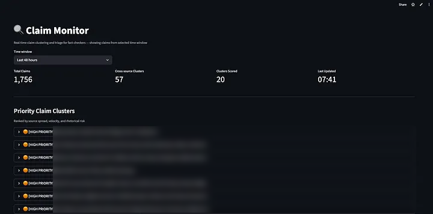
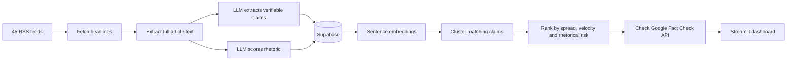

# 🔍 Misinformation Monitor

**A claim-tracking pipeline that helps fact-checkers see which claims are spreading fastest across the news, and which deserve attention first.**

  

*The live dashboard: in one 48-hour window it processed 1,756 claims and found 57 clusters carried by multiple outlets. Claim text is blurred here because it named real people in sensitive news stories.*

## The problem

Fact-checking teams are small, and the news moves fast. When the same claim appears across ten outlets in an hour, it matters more than a claim that appears once. But spotting that pattern by hand, across dozens of sources, isn't realistic.

Misinformation Monitor does that triage automatically. It pulls in news from 45 outlets across the political spectrum, breaks each article into individual checkable claims, groups claims that say the same thing, and ranks them so fact-checkers know where to look first.

The project was reviewed by experts at **[Full Fact](https://fullfact.org)** and **[AllSides](https://www.allsides.com)**.

## How it works

**1. Ingest** (`pipeline.py`). Runs in GitHub Actions and is designed for a two-hour schedule. It reads 45 RSS feeds (from the BBC and Reuters to partisan and fringe outlets, deliberately), skips reviews, opinion and lifestyle content, and extracts clean article text with `trafilatura`.

**2. Extract claims.** Each article goes to `gpt-4o-mini` with a tightly written prompt that pulls out 3–8 specific, verifiable claims. Every claim has to contain a concrete detail (a name, number, date, place or organisation) and make sense on its own.

**3. Score rhetoric.** The same article is scored from 1 to 5 on four signals, carried over from my earlier project, Videre Labs:

| Signal | Low (1) | High (5) |
|---|---|---|
| Emotional intensity | Analytical tone | Sustained high-arousal language |
| Certainty language | Heavily hedged | Declarative, no uncertainty |
| Attribution clarity | Vague sourcing | Named sources throughout |
| Framing cues | Balanced perspectives | Single dominant narrative |

These combine into a weighted **rhetorical risk score**, where vague sourcing and emotional intensity count most.

**4. Cluster** (`dashboard.py`). Claims are embedded with `all-MiniLM-L6-v2` and grouped when their cosine similarity passes 0.82, so "Inflation fell to 3.2% in March" and "UK inflation dropped to 3.2 per cent last month" land together.

**5. Rank.** Each cluster gets a priority score built from:
- **Spread:** how many different outlets are carrying it (weighted most heavily)
- **Volume:** how many times the claim appears
- **Velocity:** how quickly it spread, from under an hour to over two days
- **Rhetorical risk:** how the articles carrying it are written

Clusters are labelled 🔴 Urgent, 🟠 High priority, 🟡 Monitor or 🟢 Low priority.

**6. Check existing fact-checks.** The dashboard queries the Google Fact Check Tools API (with caching) to show whether Full Fact, Snopes, PolitiFact and others have already rated a claim.

## Tech stack

| Layer | Tools |
|---|---|
| Ingestion | Python, `feedparser`, `trafilatura` |
| AI | OpenAI `gpt-4o-mini` (claim extraction and rhetoric scoring), `sentence-transformers` |
| Storage | Supabase (Postgres) |
| Scheduling | GitHub Actions |
| Dashboard | Streamlit |
| External data | Google Fact Check Tools API |

## What I learned

- **Prompt design is engineering.** Early versions extracted vague claims like "the government is struggling". Adding hard rules (every claim needs a checkable detail) made the output usable for fact-checkers.
- **Cross-source spread is a stronger signal than volume.** One outlet repeating itself is noise; five independent outlets carrying the same claim is a story.
- **Build with the user, not for them.** This tool grew out of feedback from fact-checkers on Videre Labs, which told me they needed triage more than detection.

## Read more

- [From Persuasion to Pattern: Building a Claim Monitoring System for Fact-Checkers](https://medium.com/@itzwasiq.salman/from-persuasion-to-pattern-building-a-claim-monitoring-system-for-fact-checkers-dfcfdb3b5102)
- [Seeing Before Believing: Measuring Persuasive Architecture in Modern Media](https://medium.com/@itzwasiq.salman/seeing-before-believing-measuring-persuasive-architecture-in-modern-media-aa41f3164a6b)

## Running it yourself

1. Create a Supabase project and run [`docs/schema.sql`](docs/schema.sql)
2. `pip install -r requirements.txt`
3. Copy `.env.example` to `.env` and `.streamlit/secrets.toml.example` to `.streamlit/secrets.toml`, then add your own keys
4. Run the pipeline: `python pipeline.py`
5. Open the dashboard: `streamlit run dashboard.py`

---

Built by [Muhammad Wasiq Salman](https://github.com/itzwasiqsalman-cloud) as part of The Knowledge Society (TKS). This project is complete and no longer maintained.
